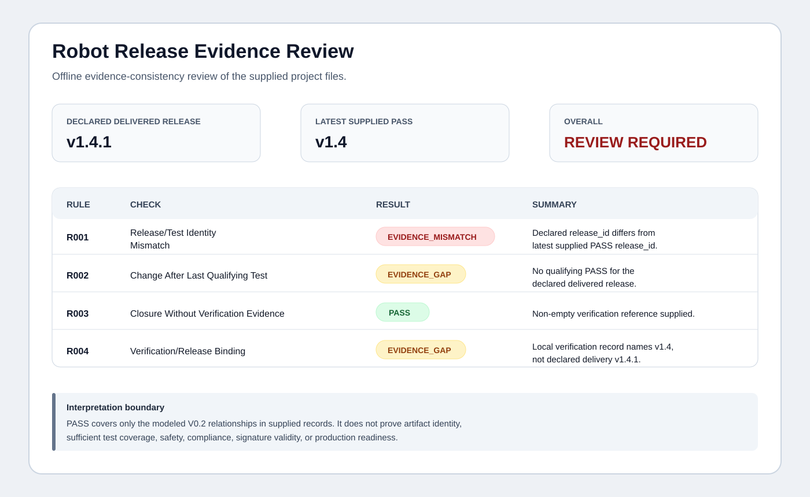

# robot-release-check

[](https://github.com/llorix218/robot-release-check/actions/workflows/test.yml)

> **Did the robot release you are delivering actually match the release your acceptance evidence covers?**

A small, offline checker for one handover problem in robot software delivery: **testing can pass, the system can change afterward, and the final acceptance package may still point to the older release.**

`robot-release-check` compares a supplied release, test evidence, post-test changes, and closure evidence. It does **not** connect to robots, production systems, CI/CD, cloud accounts, or source repositories.



## 30-second demo

Requirements: Python 3.10+.

```bash
python -m pip install .
robot-release-check ./examples/late-change \
  --html ./report.html \
  --json ./findings.json
```

The included synthetic example intentionally produces:

```text
ROBOT RELEASE EVIDENCE REVIEW

Delivered Release            v1.4.1
Latest Qualifying PASS       v1.4

R001  EVIDENCE_MISMATCH
R002  EVIDENCE_GAP
R003  PASS

OVERALL
REVIEW REQUIRED
```

Why? The example models this sequence:

```text
v1.4
  -> acceptance test PASS
  -> navigation/config changes
  -> v1.4.1 declared for delivery
  -> no later qualifying PASS evidence supplied before delivery
```

The result does **not** say the robot was unsafe or that testing never happened. It says the supplied evidence does not establish that the delivered release is covered by the latest qualifying PASS evidence.

Open `report.html` for the manager-readable report.

## What V0.1 checks

V0.1 intentionally contains exactly three deterministic checks:

| Rule | Check | Finding when evidence does not line up |
| --- | --- | --- |
| R001 | Release/Test Identity Mismatch | `EVIDENCE_MISMATCH` |
| R002 | Change After Last Qualifying Test | `EVIDENCE_GAP` |
| R003 | Closure Without Verification Evidence | `EVIDENCE_GAP` |

For V0.1, every `PASS` record placed in `tests.json` is treated as qualifying evidence. Only include PASS records that you intend to use as delivery/acceptance evidence. A PASS completed after the declared delivery time does not qualify for that delivery.

For R002, only changes whose `release_id` matches the declared delivered release are evaluated.

## Input

A project directory contains four required files.

### `release.json`

```json
{
  "release_id": "v1.4.1",
  "delivered_at": "2026-10-10T16:30:00Z"
}
```

### `tests.json`

```json
[
  {
    "test_id": "SAT-1042",
    "release_id": "v1.4",
    "status": "PASS",
    "completed_at": "2026-10-08T11:00:00Z",
    "test_type": "site_acceptance"
  }
]
```

### `changes.json`

```json
[
  {
    "change_id": "CHG-88",
    "release_id": "v1.4.1",
    "changed_at": "2026-10-09T09:15:00Z",
    "description": "Navigation parameter adjusted after SAT."
  }
]
```

### `closures.json`

```json
[
  {
    "item_id": "ISSUE-17",
    "status": "CLOSED",
    "closed_at": "2026-10-09T18:00:00Z",
    "verification_evidence": ["verification-note-17"]
  }
]
```

All timestamps must be ISO-8601 and include a timezone, for example `Z` or `+08:00`.

## Reports

```bash
robot-release-check ./examples/late-change \
  --html ./report.html \
  --json ./findings.json
```

The CLI prints a compact text result. The optional HTML output is designed to be readable by project, QA, delivery, and engineering leaders. The JSON output includes the overall status, the evidence basis, all findings, and the interpretation boundary.

## Exit codes

- `0` — all three checks PASS.
- `1` — at least one `EVIDENCE_GAP` or `EVIDENCE_MISMATCH` was found.
- `2` — the supplied project files could not be parsed or validated.

A `1` is an evidence-review result, not a statement that the physical system failed.

## Interpretation boundary

A finding means the **supplied evidence** does not establish a relationship cleanly. Missing evidence is not proof that an activity never occurred.

This utility does not determine whether a physical system is safe, whether testing happened outside the supplied evidence, whether a deployment is compliant, or whether a robot should be operated.

It is not a safety certification tool, a compliance opinion, a penetration-testing tool, or a robot-control system.

## Reviewing a real deployment?

I provide fixed-scope, independent, read-only evidence reviews for robot projects approaching customer acceptance.

A typical review examines **one project**, a small set of **redacted artifacts**, and asks:

> Does the final delivered release still line up with the supplied test evidence, post-test changes, issue closure, and handover package?

Typical scope: **8–12 redacted artifacts, 3–5 business days**. No source code, production-system access, or robot access is required.

For independent review inquiries, contact **llorix218@gmail.com**. Do not post confidential project material in a public issue.

## Scope discipline

V0.1 intentionally stops at these three checks. It has no accounts, hosted service, database, robot connector, continuous monitoring, or production integration.

## 90-second walkthrough

See [`docs/90_SECOND_DEMO.md`](docs/90_SECOND_DEMO.md).

## License

Licensed under the **Apache License 2.0**. See [`LICENSE`](LICENSE).
